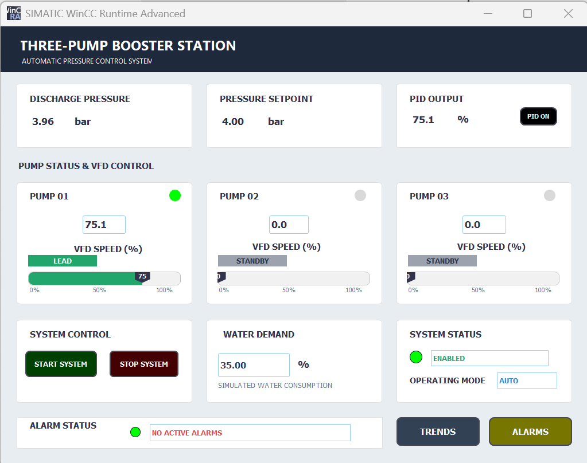
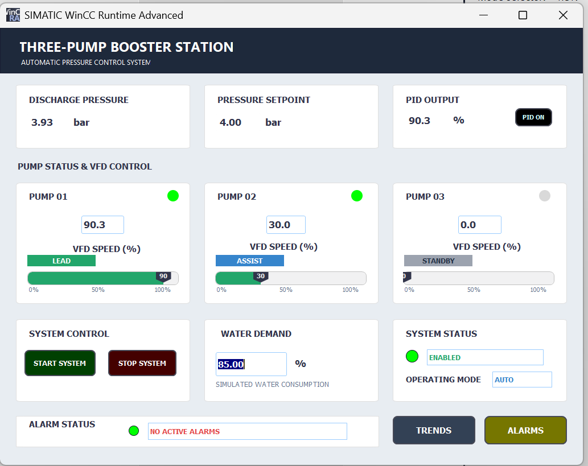
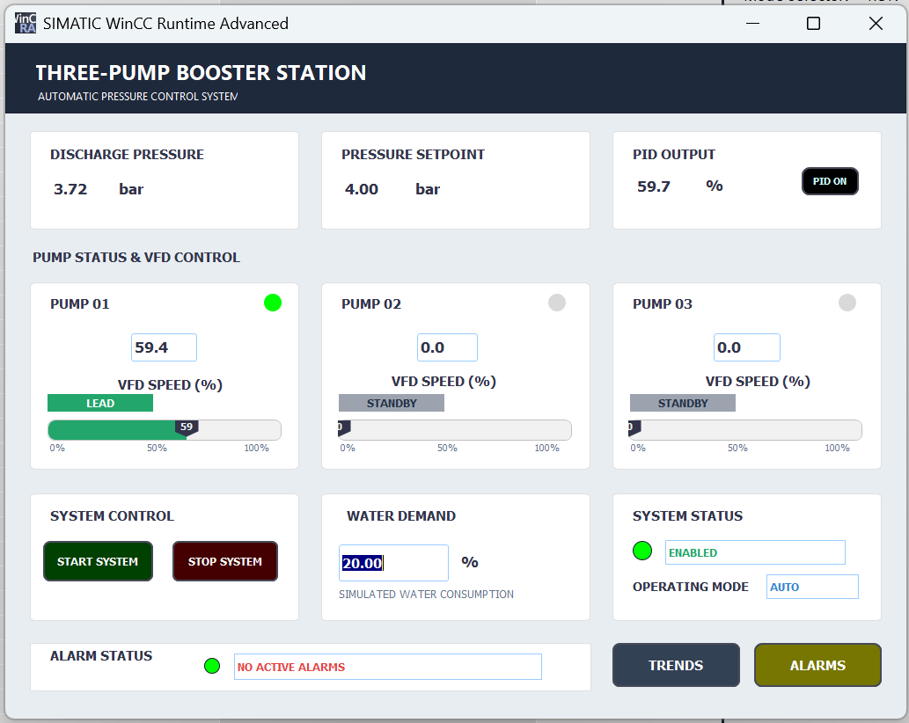
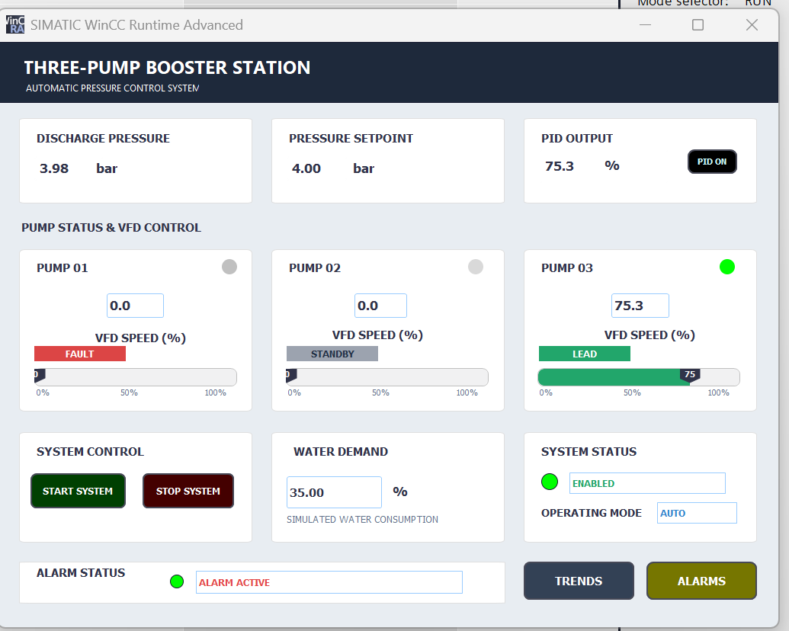
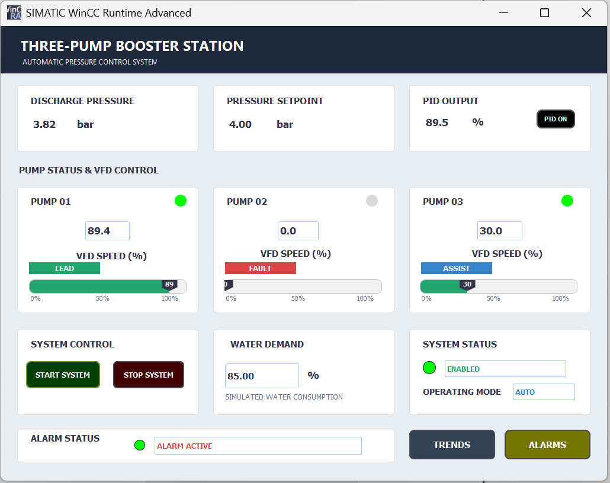
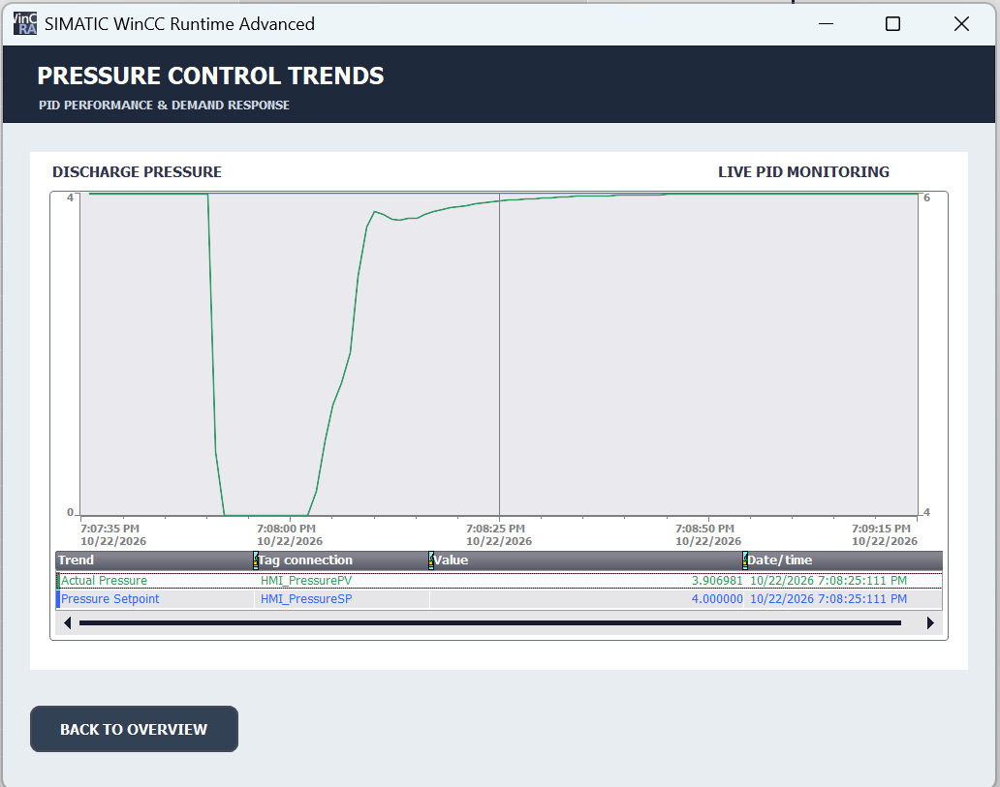
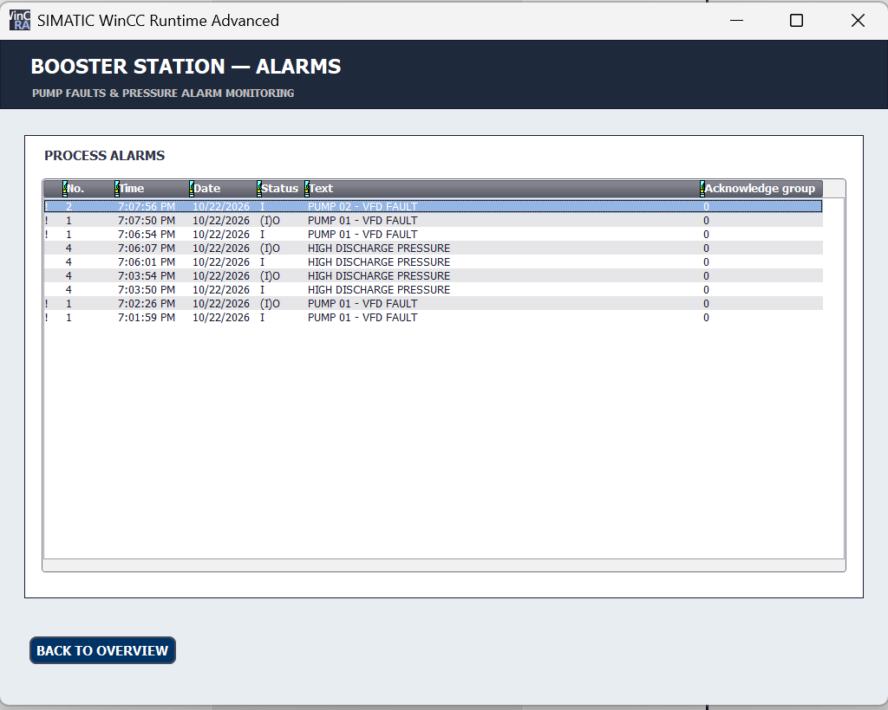

# Siemens S7-1500 — Three-Pump VFD Booster Control System

**TIA Portal V19 | S7-1500 | PID_Compact | SCL/LAD | WinCC Runtime Advanced | PLCSIM Advanced**

## Project Overview

Designed, programmed and validated a simulated three-pump VFD booster control system using Siemens TIA Portal V19.

The system automatically maintains a **4.0 bar discharge pressure setpoint** under varying water demand using Siemens PID_Compact and automatic lead/assist pump sequencing.

The project demonstrates PLC programming, closed-loop process control, VFD simulation, fault-tolerant pump operation and WinCC HMI development.

## Key Features

- **PID Pressure Control:** Automatic VFD speed adjustment using Siemens PID_Compact.
- **Lead/Assist Pump Sequencing:** Additional pump capacity automatically starts and stops according to process demand.
- **Automatic Fault Changeover:** A healthy standby pump replaces a failed lead or assist pump.
- **VFD Simulation:** Simulated motor running status, speed feedback and fault signals.
- **Hydraulic Process Simulation:** Custom SCL logic simulates changing water demand and discharge pressure.
- **WinCC HMI:** Real-time monitoring and operator control.
- **Pressure Trends:** Actual pressure versus setpoint.
- **Alarm Management:** Pump faults and high/low discharge pressure alarms.

## Software and Technologies

| Component | Technology |
|---|---|
| PLC | Siemens S7-1500 CPU 1511-1 PN |
| Engineering | TIA Portal V19 |
| Programming | SCL and LAD |
| PID Controller | Siemens PID_Compact |
| HMI | WinCC Runtime Advanced |
| Simulation | S7-PLCSIM Advanced V8 Update 1 |

## PLC Program Architecture

| Block | Function |
|---|---|
| `FB_PumpControl` | Individual VFD control and feedback simulation |
| `FB_PumpManager` | Lead/assist sequencing and fault changeover |
| `FB_ProcessSimulation` | Simulated hydraulic pressure response |
| `FB_AlarmManager` | Pump faults and pressure alarms |
| `PID_Pressure` | Closed-loop pressure regulation |
| `DB_System` | System setpoints, commands and HMI signals |
| `DB_Pumps` | Individual pump data structures |
| `OB30_ProcessControl` | Cyclic process control execution |

## WinCC HMI

The HMI includes three screens:

1. **Overview:** Pressure, PID output, pump roles, VFD speeds, water demand and Start/Stop controls.
2. **Pressure Trends:** Live actual pressure and setpoint monitoring.
3. **Alarm Monitoring:** Pump-fault and high/low pressure alarm events.
## Project Screenshots

### 1. Normal Operation — 35% Demand

### 2. High Demand — 85% Demand

### 3. Low Demand — 20% Demand

### 4. Pump 1 Fault — Automatic Lead Changeover

### 5. Pump 2 Fault — Automatic Assist Changeover

### 6. PID Pressure Trends

### 7. Alarm Monitoring

## Testing and Validation

| Test Scenario | Result |
|---|---|
| Normal demand — 35% | Pressure maintained near 4.0 bar |
| High demand — 85% | Assist pump started automatically; pressure stabilised at 4.00 bar |
| Low demand — 20% | Assist pump stopped automatically |
| Pump 1 fault | Healthy standby pump took over as lead |
| Pump 2 fault | Healthy standby pump took over as assist |
| Alarm testing | Pump and pressure alarms displayed in WinCC |
| PID response | Pressure recovery verified using live trends |

## Project Documentation

The repository will include:

- TIA Portal V19 project archive
- Technical engineering report
- WinCC HMI screenshots
- Simulation test evidence
- Demonstration video link, when available

### Technical Engineering Report

[View the Full Engineering Report (PDF)](docs/Three_Pump_Booster_Engineering_Portfolio_Report.pdf)

The report covers PLC architecture, PID control, pump sequencing, fault changeover, WinCC HMI development and simulation validation.

### Download TIA Portal Project

[Download Siemens TIA Portal V19 Project (.zap19)](project/Three_Pump_Booster_Control_Final.zap19)

The archive contains the Siemens S7-1500 PLC program, Function Blocks, PID_Compact configuration, data blocks and WinCC HMI project.

**Requirements:** Siemens TIA Portal V19 and compatible
Siemens simulation/runtime software.

**Note:** This project is intended for simulation and educational demonstration, not direct deployment on physical equipment.

## Engineering Scope

This is a **software simulation and validation project**. Pumps, VFDs, instrumentation and hydraulic behaviour are simulated. No physical equipment was commissioned.

## Author

Personal industrial automation engineering portfolio project.
